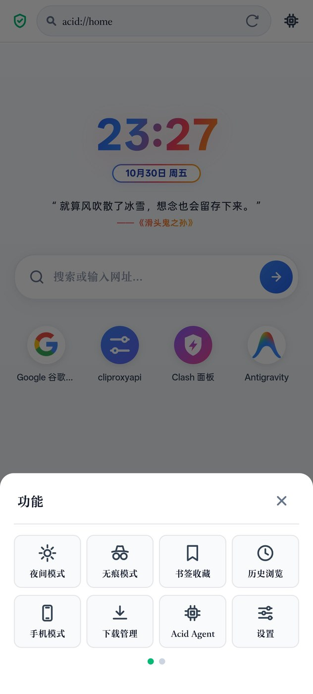
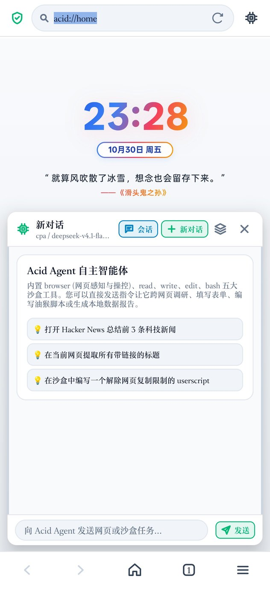

# Acid Browser

**Acid Browser** is an ultra-lightweight, zero-dependency intelligent browser for Android.

[English](README_EN.md) | [中文说明](README.md)

Built on the native `WebView` system, Acid Browser does not rely on AndroidX or any heavy external SDKs, resulting in an installation size of only about **520 KB**. It provides a clean, smooth web browsing experience while natively integrating an autonomous AI Agent Loop, a local sandbox workspace, a userscript engine, an ABP-compatible ad blocker, and a standard MCP (Model Context Protocol) gateway.

<p align="center">
  
  
  
</p>

---

## Key Features

- **Autonomous AI Agent**: Built-in sandbox tools (`browser`, `read`, `write`, `edit`, `bash`) for autonomous task execution without external plugins.
- **MCP Gateway**: Standard local Model Context Protocol server for remote control from desktop tools like Cursor or Claude Desktop.
- **Userscript Engine**: Native support for Tampermonkey-style scripts (`.user.js`) with metadata parsing and execution isolation.
- **Ad Blocker**: Integrated ABP-compatible engine supporting custom rule subscriptions and high-performance domain-based filtering.
- **Zero-Dependency**: Pure Java/Android framework implementation for maximum performance and minimal binary footprint.

---

## Getting Started

1. Install `build/Acid-browser.apk`.
2. Input keywords or URLs in the address bar to browse.
3. Access **Settings > Model Config** to add your AI providers (DeepSeek, Kimi, Qwen, Ollama, etc.).
4. Use **Acid Agent** to start autonomous web research or sandbox tasks.

---

## Build & Test

### Prerequisites
- Linux / macOS
- JDK 8+
- Android SDK Build Tools (API 24+)

### Commands
```bash
# Build APK and run full regression test suite
./build.sh

# Run core JVM test suite (14 modules)
./test.sh
```

---

*For detailed documentation and feature guides, please refer to the [中文说明](README.md).*
